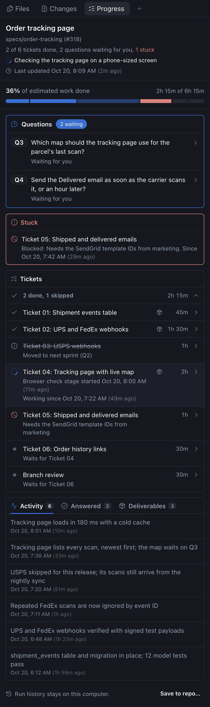
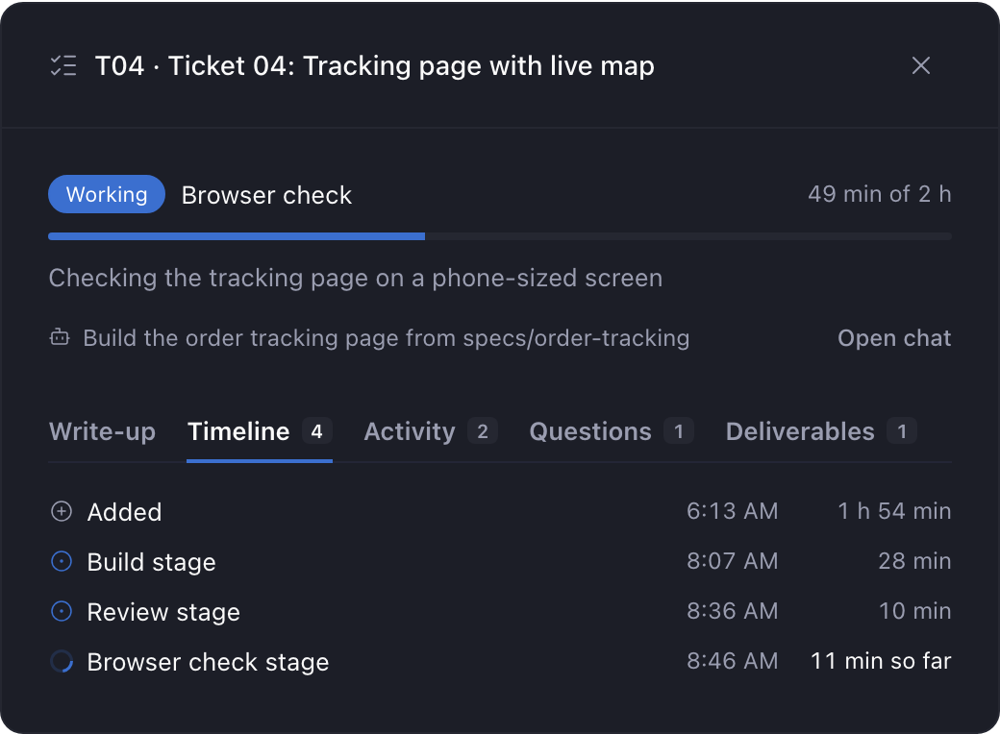
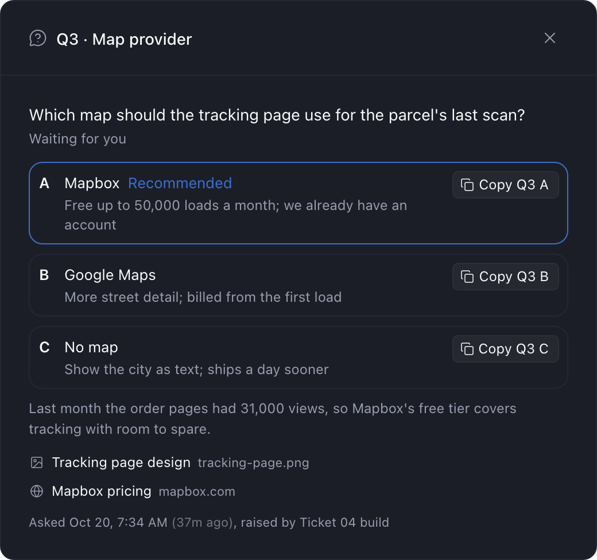
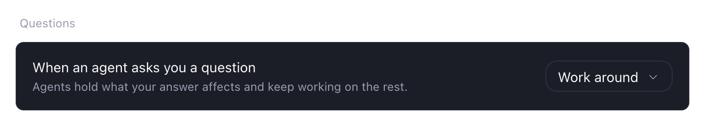
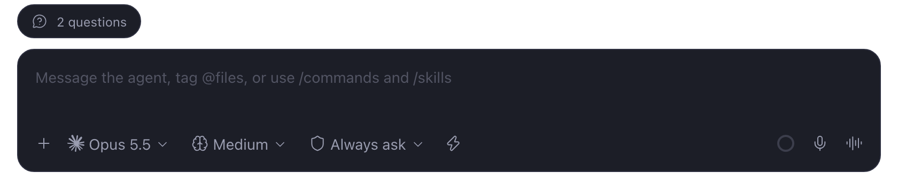

# Progress

A plugin for Paseo 0.11 and later that gives each worktree a live progress dashboard. Agents record progress with the `paseo-progress` command, which adds one line per change to the worktree's progress file. That file lives outside the repo, so git never sees it. The **Progress** panel draws the dashboard from that file and updates by itself.



The dashboard shows:

- the run's title, a headline ("2 of 4 tickets done, 5 questions waiting for you, 1 stuck"), a one-line "now" ticker, and when it was last updated
- a "possibly stale" warning after 15 minutes with no update while tickets remain, unless Paseo shows an agent in the workspace still running, and never once every ticket is done or skipped or the run is finished; working items swap their spinner for a pulsing amber warning
- percent of estimated work done, time done of time estimated (like "1h 30m of 2h"; once everything is done, how long it really took), and a bar with one segment per ticket
- **Stuck:** blocked tickets, working tickets with no update for longer than their estimate, and blockers the agent flags
- **Tickets:** estimate, status, and the working ticket's stage. A ticket that waits for another (`--waits-for T03`) shows "Waits for Ticket 03" under its title until that one is done; waiting is the order of work, so it never counts as stuck, even if the agent also marked it blocked. Press a ticket for its story in a dialog. A summary on top shows its status and stage, time worked against the estimate as a bar that turns red past it, the agent's latest status line while it's working, and the agent on it. Tabs below hold the rest, each only when it has something: the ticket's write-up when it has a `--source` file (the start of it, with the rest a press away), a timeline of its stages and statuses with how long each took, and the activity, questions and deliverables that belong to it. The agent on a ticket shows by its chat title; pressing it opens that chat. Items tagged with `--ticket` belong exactly; older, untagged ones are matched by when they happened and marked "by time"
- **Questions:** each with a permanent reference (Q1, Q2, ...), lettered options, and the option the agent recommends. You pick what the agent does while you decide in Paseo's Settings (Settings, Plugins, Progress, Questions). **Stop**: it stops all work until you answer. **Work around**, the default: it holds what your answer affects and keeps working on the rest. **Keep building**: it builds its recommendation and changes course if you pick another, except for big questions, which wait. A question is big when building ahead would send something off your computer, when the answer sets something people or programs outside the repo rely on, or when most of the remaining work would be built on it. Each open question shows what the agent is doing: "Agent stopped until you answer", "Waiting for you" (with the reason when it's big), or "Building with B: <its label>". Press a question to open it in a dialog, then press **Copy Q2 B** to copy `Q2 (title): B` for your reply. Files and links the agent attached (`--file`) open like deliverables: images, videos and text files preview in Paseo (with **Back** to the question), a folder lists its files there, links open in Paseo's browser, and other files open in their default app. From the pill's popover, the preview opens over the popover, which stays open so you can go back to it. Answers stay listed under the same reference.
- **Activity**, **Answered** questions and **Deliverables** (press one to open it), sharing one card with a tab for each; the panel remembers the tab you picked. Each shows the newest 10, with **Show 10 older** below

 



The panel lives in Explorer, beside the agent chat, so you can watch both. Open it from Command Center with **Open Progress**. When questions are waiting or something is stuck, a pill above the message box says so, for example `3 questions`. With something stuck too, it shortens to `3Q · 1 stuck` to fit. Pressing it opens a popover with each open question, its choices and their Copy buttons, and what is stuck, so you can answer without leaving the chat. **Open Progress** at the bottom opens the panel in Explorer.



On phones, where Paseo has no Explorer pane, Progress opens as a tab of its own, and the pill stays above the message box while a run is open so there's always a way in. SVG files and videos preview on desktop; on phones they open on the daemon host.

The first time a run starts in a worktree whose Progress panel has never been opened, the pill shows a spinner and reads **Progress** instead; pressing it opens the panel. Once the panel has been opened there, the plugin writes an empty `progress-panel-opened` file next to the progress file and the nudge never comes back, even for later runs. It doesn't open the panel by itself because Paseo switches to a workspace to open its panel, which would pull you away from whatever you're looking at.

## Install

```sh
paseo plugin add npm:@stevecastaneda/paseo-progress
```

Or from Paseo's plugin registry: `paseo plugin add stevecastaneda/progress`.

Enable plugins under **Settings → Plugins** on the Paseo host. You need Node.js 22.18 or later on the daemon host.

Then install the `paseo-progress` command agents run. Open **Progress** from Command Center and press **Install command** in the banner. It adds one file, `~/.local/bin/paseo-progress`, on the machine running the Paseo daemon, and the banner disappears once agents can run it. On Windows it also adds `paseo-progress.cmd` next to it, because PowerShell and cmd only run files with an extension like `.cmd`. The plugin writes nothing until you press it, and it never replaces a file something else put at that path.

To install from a terminal instead, or to put the command somewhere else:

```sh
dir="$(paseo plugin ls progress --json | node -pe 'JSON.parse(require("fs").readFileSync(0))[0].path')"
node "$([ -f "$dir/dist/server/cli.js" ] && echo "$dir/dist/server/cli.js" || echo "$dir/server/cli.ts")" install-launcher [path]
```

If `paseo` isn't on your `PATH`, use `/Applications/Paseo.app/Contents/Resources/bin/paseo`. The command doesn't name a plugin folder: each run asks Paseo (`paseo plugin ls`) which copy of the plugin it is running and runs that copy, so it keeps working after updates and `npm run dev` switches. The npm package carries the command as one JavaScript file in `dist/`, built with esbuild when publishing, because Node won't run TypeScript from `node_modules`. That file includes zod (MIT), so installing the plugin downloads no other packages.

The command, and **Install skill** in the panel, look for Paseo's own command in this order:

1. `PASEO_BIN`, if you set it.
2. `PASEO_CLI`, which Paseo sets for the agents it starts.
3. `paseo` on your `PATH`.
4. The app's default install: `/Applications/Paseo.app/Contents/Resources/bin/paseo` on macOS, `%LOCALAPPDATA%\Programs\Paseo\resources\bin\paseo.cmd` on Windows.

Setting `PASEO_PROGRESS_PLUGIN_DIR` to a plugin folder makes the command run that copy without asking Paseo. Use it only for testing, because an installed plugin's folder changes with every update.

## Where progress is kept

Each worktree's progress lives outside the repo, in its own folder under `~/.local/state/paseo-progress/` on the daemon host. There's nothing to set up and nothing to hide: git never sees these files, and the plugin never edits a `.gitignore` or git's exclude file. The panel's empty state shows the exact path.

### Saving run history to the repo

If you want to keep runs, at the bottom of the panel press **Save to repo…** and pick a folder (or name a new one). From then on, each run is saved as its own file there, like `history/20261001-064512-export-feature.jsonl`, and updated as the run goes. Commit them like any other file. One file per run means two branches never write the same file, so merges don't conflict. The lock and the panel marker never go there.

The choice covers every worktree of the repo and is kept in the repo's local git config (`paseo-progress.saveRuns`), which nothing commits. **Change…** picks another folder for future runs; **Stop saving** turns it off. Files already saved are never moved or deleted.

### Upgrading from 0.1.x

Earlier versions kept progress in `.scratch/` in each worktree, hidden by a `.scratch/.gitignore` they wrote. The first time the command or the panel touches a worktree after the upgrade, the plugin moves its files out of `.scratch/` and removes that `.gitignore` if it's exactly the one the plugin wrote. If `.scratch/` is then empty, it goes too; anything else you keep there stays. If git tracks the old progress file (for example, an agent committed it), the plugin leaves it where it is and keeps using it, so nothing changes in that repo.

## Agent skill

The plugin ships an agent skill, `paseo-progress`, that tells agents when to run each command during a multi-ticket job: set up the run, move tickets through their stages, ask questions, and finish. It stays short and leaves the details to `paseo-progress --help`. Press **Install skill** in the Progress panel. It links `paseo-progress` into `~/.agents/skills`, `~/.claude/skills`, and `~/.codex/skills` (the folders Paseo installs its own skills into), pointing at the copy of the plugin Paseo runs, so plugin updates reach agents. On Windows the links are junctions, which don't need admin rights or Developer Mode. If Paseo later runs the plugin from somewhere else, the button changes to **Update skill**. It never replaces a skill it didn't link; that folder is skipped.

From a terminal instead:

```sh
skill="$(paseo plugin ls progress --json | node -pe 'JSON.parse(require("fs").readFileSync(0))[0].path')/skills/paseo-progress"
for dir in ~/.agents/skills ~/.claude/skills ~/.codex/skills; do mkdir -p "$dir" && ln -s "$skill" "$dir/paseo-progress"; done
```

## Recording progress

Run `paseo-progress --help` for every command, and `paseo-progress <command> --help` for one. Commands find the worktree root from the current directory.

```sh
paseo-progress start "Loan Options snapshots" --subtitle "4 tickets"
paseo-progress ticket add "Ticket 01: Saved table" --estimate 120 \
  --source specs/01-saved-table.md                                     # Added T01
paseo-progress ticket update T01 --status working --stage Build
paseo-progress ticket update T01 --stage Fixes
paseo-progress ticket update T01 --status done
paseo-progress question ask "Row spacing" "Even out the card spacing?" \
  --option "A=Even it out | Cards look balanced" \
  --option "B=Leave it | No change" \
  --recommend A --raised-by "Ticket 01 design review"                   # Asked Q1
paseo-progress question answer Q1 A --words "Even it out."
paseo-progress deliverable add "Browser check screenshots" .scratch/shots/ --ticket T01
paseo-progress activity add "Saved table matches the design now." --ticket T01
paseo-progress ticker set "Running the browser check"
paseo-progress stuck set "Staging is down" --ticket T01                 # Flagged S1
paseo-progress show
paseo-progress finish "Snapshots ship for all four tables"
```

- Statuses are `not_started`, `working`, `blocked`, `done`, and `skipped`. Skipped tickets leave the totals.
- `ticket add` and `ticket update` take an optional `--source <path or link>[=<label>]`: where the ticket is written up, like its spec file or issue. It shows under the ticket's status in its dialog and opens like a deliverable. `--source ""` clears it. Tickets without one are fine.
- A working ticket is stuck once it goes longer than its estimate without an update, timed from its last status, stage or note change, or activity tagged to it. The ticket's dialog still shows total time worked against the estimate.
- `question ask` needs `--recommend`, the agent's pick. The question dialog tags that option "Recommended". Its output tells the agent the question mode and what to do until the answer. `--big "<why>"` marks a big question, which waits for the answer even in Keep building. `start` and `show` also print the mode.
- Paseo keeps the question mode in its own settings, which only the plugin's server can read, so the server copies it to `~/.local/state/paseo-progress/settings.json` for the command. Without that file, for example while the plugin is off, the command uses Work around.
- Deliverable paths are stored relative to the worktree root. Web links open in Paseo's browser. Pressing an image (PNG, JPEG, GIF, WebP, up to 10 MB) or text deliverable (Markdown, text, logs, JSON, YAML, CSV; the first 256 KB) previews it in a dialog inside Paseo, which also works from a phone; **Open** there opens the file in its default app. **Open** shows only when the computer running Paseo can open files. A Linux server with no desktop can't, so there a file Paseo can't preview copies its path and says why. A video (MP4, MOV, WebM, up to 200 MB) plays in the same dialog in the desktop app. When there are several files, **Previous** and **Next** step through them, and so do the left and right arrow keys. Pressing a folder lists its files in the same dialog. Press a file to preview it, or a folder inside to list that one, and **Back** returns to the list. Pressing any other local deliverable opens it with its default app on the machine running the Paseo daemon (for example HTML in your browser). On macOS, **Open** sends text files to your default browser. Only recorded deliverables inside the worktree open this way; otherwise the path is copied. The copy icon on each row copies the path.
- Several agents can share one run. When another session adds a ticket, each agent sees it at the end of its next command's output (and in `show`), and the skill has it work that ticket in order after its current one. An agent only hears about tickets added since its own last update in the run, and only once.
- Subagents record their own progress. Since Paseo 0.11, an agent waiting on background subagents shows as idle, so only the subagents' updates show the work is still going. The skill has the agent give each subagent the worktree path and ticket id, and the subagent records its stages and a ticker line on that worktree's dashboard.
- `start` begins a fresh dashboard. Earlier runs stay in the file. Question references stay unique across runs.
- `finish "<outcome>"` closes the run once every ticket is done or skipped, no question is open, and nothing is flagged stuck; otherwise it says what is left. The run stays on the dashboard, marked Finished with its outcome, and takes no more updates, so the next agent in the worktree starts a new run instead of adding to it.

## The progress file

The progress file, `progress.jsonl`, holds one JSON event per line, each with a version (`v`), a UTC timestamp (`ts`) from the real clock, and a `type`. Events written by a Paseo agent also carry its agent id (`by`). It is only ever appended to, so you can read or diff the history. A half-written last line is ignored. Other bad lines are skipped and listed in a small notice in the panel while the rest still renders. A lock keeps two commands from writing at once or handing out the same id.

## Limitations

- An agent hears about tickets other sessions added only when it next runs `paseo-progress`. One in the middle of a long step finds out when that step ends.
- Nothing updates unless the agent runs `paseo-progress`. Agents need the skill, and an agent that skips the command leaves the dashboard behind.
- On Paseo 0.11 and later, an agent waiting on background subagents counts as idle. If those subagents record nothing, the dashboard shows "possibly stale" after 15 minutes while they're still working.
- The command runs on the machine that hosts the Paseo daemon, and it needs Node.js 22.18 or later there.
- Each worktree keeps its own dashboard. There's no view across worktrees.
- Progress folders outside the repo stay behind when a worktree is deleted. They're small, and you can delete them from `~/.local/state/paseo-progress/`.
- Paseo can't open a panel without switching you to its workspace. So a new run shows a "Progress" pill, and you open the panel yourself.
- Pills check busy worktrees every 5 seconds and quiet ones every 30. In a quiet worktree, a new question can take up to half a minute to show.
- Previews cover images up to 10 MB, videos up to 200 MB (desktop app only), the first 256 KB of a text file, and the first 500 items in a folder. The folder list leaves out hidden files. Other files open in their default app. A video the app can't decode shows the player's error, and **Open** still works.
- Stale warnings and overdue times use the daemon host's clock.

## Changelog

### 1.3.1

- Progress works on Windows (#84). Before, `paseo-progress` stopped with "The progress plugin is not installed in Paseo", and **Install skill** couldn't find the plugin. On Windows, Paseo's command is `paseo.cmd`, and Node can start a `.cmd` file only through cmd. Both now go through cmd on Windows, and both also check where Paseo installs its command.
- On Windows, **Install command** also adds `paseo-progress.cmd`, so agents in PowerShell or cmd can run `paseo-progress`, not just those in Git Bash.
- On Windows, **Install skill** makes junctions instead of symlinks, so it works without admin rights or Developer Mode.
- The banner no longer says the command's folder is missing from `PATH` on Windows when it's there.
- If you worked around this by hand, delete your own `paseo-progress.cmd`, then press **Update command**. Also remove `PASEO_PROGRESS_PLUGIN_DIR`, or the command keeps running the folder it names after the plugin updates. Skill links you made yourself keep working, and the panel offers **Update skill** once the plugin folder changes.

### 1.3.0

- The file preview has a **Copy** button beside the path. It copies the full path, so you can paste it into your message to the agent without closing the preview. Before, the path was cut off when it was long, and you had to close the preview and copy it from the list.
- The path stays in view below a tall image or long file. Before, it scrolled with the file and you had to scroll to the bottom to see it.

### 1.2.0

- A folder deliverable opens in Paseo as a list of its files. Press a file to preview it, or a folder inside to list that one; **Back** returns to the list. This works from a phone and when the worktree is on another computer. Before, Progress asked the computer running Paseo to open the folder. On a Linux server with no desktop, that failed with `spawn xdg-open ENOENT`.
- A folder attached to a question lists its files the same way.
- Every **Back** button says just **Back**. Before, it named where it went, like **Back to Q3**.
- The preview hides **Open** when the computer running Paseo can't open files, like a Linux server you reach over ssh. There, a file Paseo can't preview copies its path and says why: `Can't open files on my-server. Copied path`.
- Error messages in the panel no longer end in Paseo's `requestType=… code=…` text.

### 1.1.0

- Videos play in the preview. MP4, MOV and WebM files up to 200 MB play in Paseo's desktop app, with a loading percentage while they arrive. On a phone, a video opens on the computer running the Paseo daemon, as before.
- The left and right arrow keys move to the previous and next file in a preview. **Next** has focus when the preview opens, so Enter moves on too.
- An image too tall for the preview, like a phone screenshot, could make it flicker between two sizes until you closed it. It now opens at its real shape and holds still.

### 1.0.0

- Version 1.0. Nothing you use changes. From now on, a new first number means an update breaks something, a new middle number means a new feature, and a new last number means a fix.
- The pill above the message box fits again when questions are waiting and something is stuck. It reads `2Q · 1 stuck`. Before, Paseo cut it off at `2 questions · 1 st…`.
- A time like `(11m ago)` moves to the next line whole. It no longer splits in the middle.
- Every duration uses one style, like `2h 15m`. Before, the progress bar said `2 h 15 min` and the finished tickets said `2.3 h` for the same work. Estimates show the minutes you set, so a 90-minute ticket reads `1h 30m`, not `1.5 h`.
- New screenshots in this README.

### 0.4.0

- Needs Paseo 0.11 or later. The plugin now carries its own icon and screenshots, and Paseo 0.9 and 0.10 refuse to load a plugin that does. On an older Paseo, the version you already have keeps working.
- The plugin store now takes the icon and screenshots from each release, so they match the version you install.
- New screenshots in this README.

### 0.3.5

- The plugin's page in Paseo's plugin store now says that pressing **Open** in a preview opens the file in an app on the computer running the Paseo daemon, even from your phone.

### 0.3.4

- Installing the plugin no longer downloads any other npm packages. The `paseo-progress` command is now built into a single file that includes zod. The plugin used to install `@getpaseo/client` just for its types; it now gets them from the plugin SDK that Paseo already provides.

### 0.3.3

- The skill now has subagents record their own progress, so the dashboard stops warning "possibly stale" while they work. Since Paseo 0.11, an agent waiting on background subagents shows as idle. After 15 minutes with no update, the dashboard said the work may have stopped even though the subagents were still at it. Now the agent gives each subagent the worktree path and ticket id, and the subagent records its stages and a ticker line. If the Progress panel shows **Update skill** after you update, press it so agents get the new instructions.

### 0.3.2

- The plugin's page in Paseo's plugin store now uses the plugin's own description instead of text the store copied from paseo.cafe.

### 0.3.1

- Installs again with npm 12. Installing failed with `npm ci` asking for a `package-lock.json`, because npm 12 no longer reads the lockfile this plugin shipped ([#53](https://github.com/stevecastaneda/paseo-plugins/issues/53)). The plugin no longer runs its own install step; Paseo's npm install already brings in what it needs.
- Install from npm or Paseo's plugin registry. Installing straight from GitHub no longer works.
