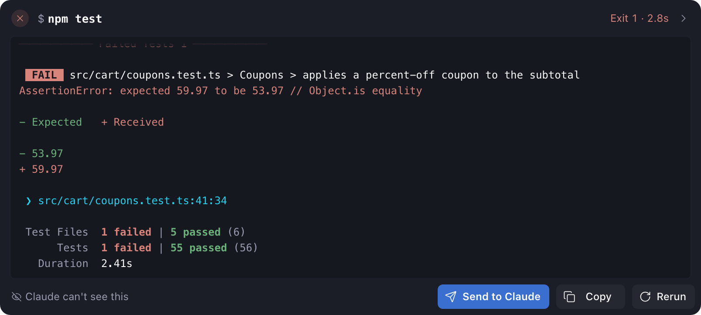
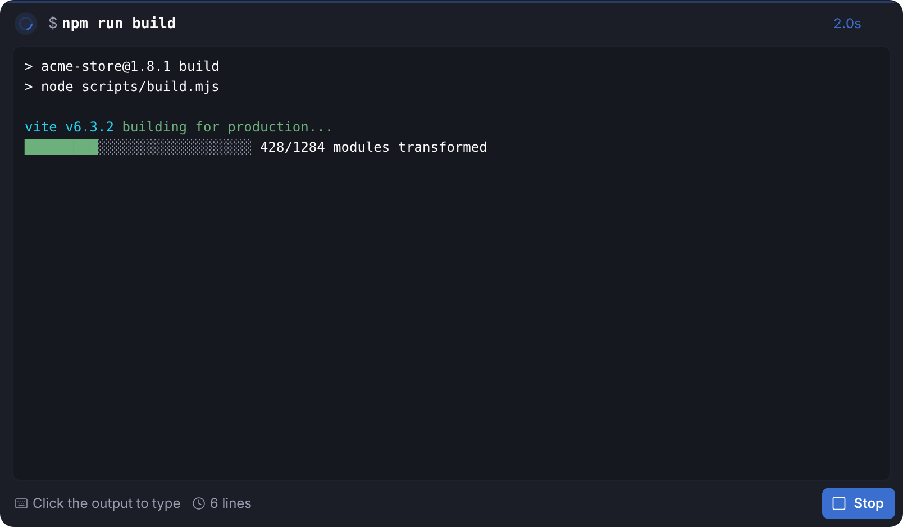
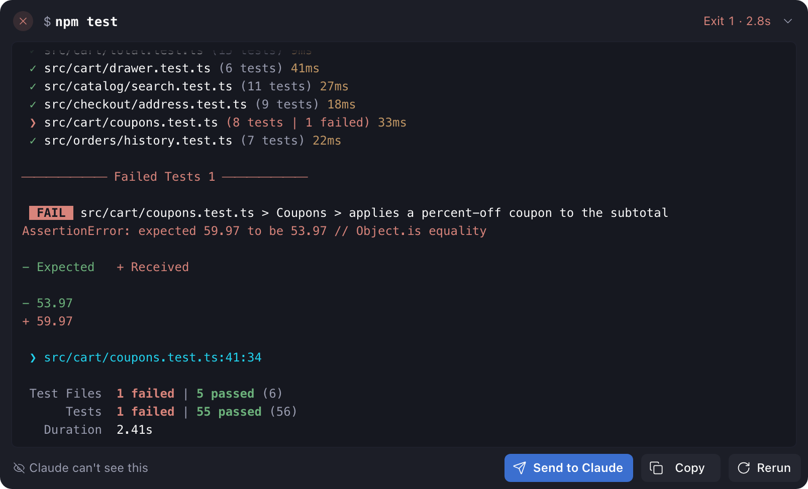
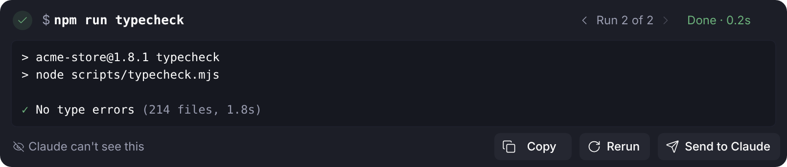
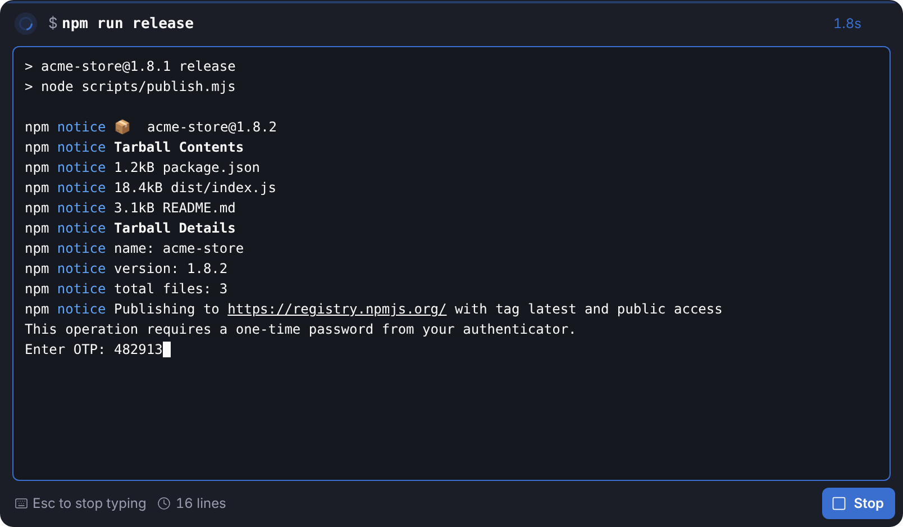
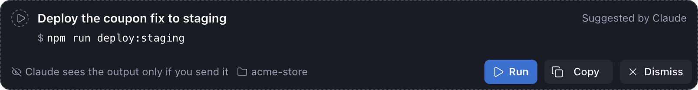
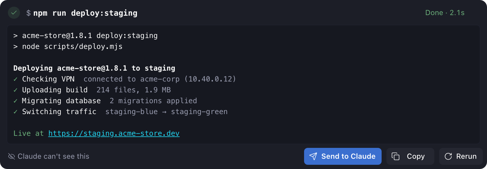
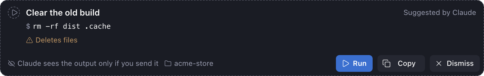
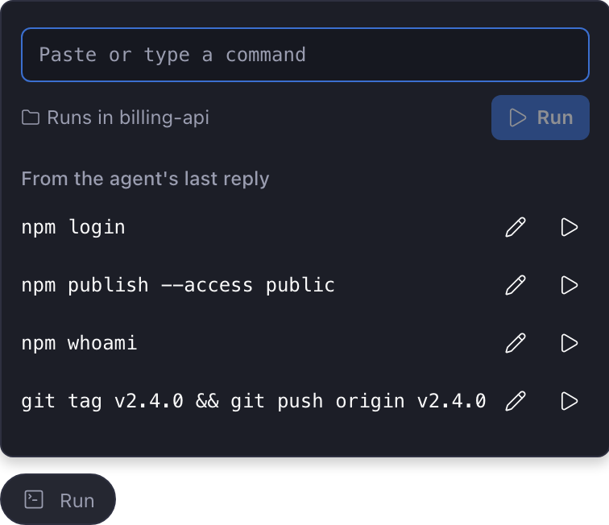

# Shell Yeah

A plugin for Paseo 0.11 and later. Type `/sh` and a command in the message box to run it yourself, in the agent's folder, with live output in the chat. The agent sees the output only if you send it.

It's the Paseo version of Claude Code's `!` mode. It's also how an agent hands you a command it can't run itself: a login that needs your browser, a deploy behind your VPN, a publish that needs your 2FA code. The command shows up under the agent's reply with a **Run** button.



## Running a command

Type `/sh npm test` and press Enter. A card appears in the chat:

- While the command runs: a spinner, a timer, the output as it arrives in a box you can type into, and **Stop**. Progress bars and spinners redraw in place, the way they do in a terminal.
- When it ends: **Done** or **Exit 1** with how long it took, the colored output, and **Send**, **Copy** and **Rerun**. Buttons and notes name the chat's agent: **Send to Claude** in a Claude chat, **Send to Codex** in a Codex chat.



The output box holds the last 300 lines and stays on the newest one while the command runs. Once a command has run for a second, the box opens to 20 lines, like a terminal window, so a setup wizard or a long build has room. When the command ends, the box shrinks to fit the output. On a phone the box always fits the output, so a prompt stays in view when the keyboard opens. Scroll up for earlier lines; **Jump to latest** brings you back. The arrow in the header makes the box taller, up to 60% of the window. **Copy** copies everything the plugin kept, up to 10,000 lines.



**Rerun** runs the command again in the same card. The arrows next to **Run 2 of 2** go back through earlier runs, up to 10. Each shows its result and the end of its output. **Send** and **Copy** use the run you're looking at.



The command runs on the Paseo host as the user Paseo runs as, in the agent's working folder, with your shell (`$SHELL -c`). It skips interactive startup files like `.zshrc`, so aliases aren't loaded. Your PATH carries over. On Windows, the command runs in PowerShell 7 if it's installed, otherwise in the Windows PowerShell that comes with Windows. It skips your PowerShell profile for the same reason.

Each command gets a terminal of its own, so it behaves as it does in yours. When it asks for a 2FA code, a password or a yes or no, click anywhere in the output box and type, as you would in a terminal. The box's border lights up while your keys go to the command. On a computer, after you press **Run** or **Rerun** in a card, they go there without a click. Each key goes to the command as you press it, so a one-key menu takes one key and arrow-key menus work. What you type shows only if the command shows it, so a password stays hidden. **Esc** stops typing. On a phone, tap the output. When a command prints a sign-in link, like npm's browser sign-in, click the link in the card. **Stop** works like Ctrl+C. Pagers are off, so `git log` prints everything instead of waiting for you to press q. When the command ends, the plugin closes its terminal. Like closing a terminal window, that also ends any background job the command started, unless you started it with `nohup`.



The plugin drops a leading `! ` or `$ `, so you can paste a command straight from a README.

## Sending output to the agent

Nothing reaches the agent until you press **Send**. The chat then shows one line, like ``Output of `npm test` (exit 1, 2.9s) · all 29 lines attached``. The agent gets the command and its output as an attachment, which Paseo doesn't display, so that line says what went along. If the agent is in the middle of a turn, the output joins that turn instead of interrupting it. If the agent is waiting for you to approve something, the plugin asks you to answer that first.

Output of up to 200 lines goes whole. Longer output goes as a summary: the first 10 lines, the last 60, and the lines that look like errors, with their line numbers. The plugin saves the full log to a file and gives the agent its path, so the agent can read or search the rest itself. The chat line then says ``summary attached, full 12,408-line log saved for the agent``.

Saved logs go in `~/.local/state/shell-yeah/logs` (`%LOCALAPPDATA%\shell-yeah\logs` on Windows), one folder per chat, never in your project. They clean up on their own. Archiving a chat deletes its logs, and archiving a workspace archives its chats. Any log older than a week is deleted, and past 100 MB the oldest logs go first.

The footer says where things stand: **Claude can't see this** before you send, and **Sent to Claude 10:42** after.

You can also attach a command's output to your next message: open the attach menu in the message box and pick it under **Command output**.

## Commands from the agent

Agents created after you install the plugin learn one rule: when they want you to run something, they put it alone in a fenced block marked `sh run`, under a one-line comment that says in plain words what it does. The rule also says never to leave a command for you only in a sentence.

````markdown
```sh run
# Deploy the coupon fix to staging
npm run deploy:staging
```
````

When the reply ends, the plugin adds a card under it: the agent's comment as the title, the command, **Suggested by Claude**, and **Run**, **Copy** and **Dismiss**. Nothing runs until you press **Run**. The shell skips the comment line, and **Copy** leaves it out. Without the plugin, the block is an ordinary shell code block.



After **Run**, the card shows the output like any other run, and **Send to Claude** is the main button.



The card also warns you, in amber, when the command is hard to undo: when it runs as administrator (`sudo`), deletes files, throws away uncommitted changes, force-pushes, or runs a script downloaded from the internet. The plugin spots these by itself, in bash and in PowerShell, so the warning shows even when the agent didn't mention it. It catches the common forms, not every disguise, so still read the command.



Agents that started before the plugin was installed don't know the rule. Type `/sh` on its own and the plugin looks through the last reply for any shell code block and offers each one, up to four.

## The Run pill

Agents still write a command into a sentence now and then: "sign in with `npm login`, then publish with `npm publish`". The **Run** pill above the message box handles those. It opens a small window that lists the commands in the agent's last reply, up to eight, from Run cards, shell code blocks and sentences. Press one to run it as a card in the chat. The pencil puts it in the box first so you can change it. Or paste any command into the box and press Enter. Shift+Enter adds a line.



Code in a sentence, or in a block with no language, counts when it starts with a program on your PATH, a shell builtin like `cd` or a script in the agent's folder. On Windows, a PowerShell command like `Get-ChildItem` counts too. Code in a sentence also needs a second word, so a passing mention of `git` doesn't show up, and neither does a file name like `package.json`. The window shows the same amber warnings as the cards.

## Agents

`/sh`, **Copy** and **Rerun** work in any chat, because the plugin runs the command, not the agent. So far I've tested **Send** only with Claude.

Run cards need the agent to know the `sh run` rule. Paseo passes it to new Claude, Codex, OpenCode, Pi and Oh My Pi chats. On Windows, the rule also tells the agent to write PowerShell. Agents Paseo runs over ACP, such as Copilot and Cursor, don't get it; type `/sh` on its own to turn the shell blocks in their last reply into Run cards, or open the **Run** pill. The pill works with every agent.

## Limits

- Full-screen programs like `vim` or `top` don't work in a card. Use a terminal tab for those.
- Up to 8 commands run at once across all chats. The plugin keeps the last 30 finished ones for **Copy** and **Send**; older cards fall back to the lines they show.
- Paseo only treats `/sh` as a command when the message box has no attachments. With an attachment, `/sh npm test` goes to the agent as text.
- Cards show live output only while the plugin is running. After Paseo restarts, a card that was still running says **Interrupted**, and finished cards keep the lines they ended with.
- The terminal comes from node-pty, the library Paseo uses for its own terminals. Paseo doesn't promise plugins that library. If a Paseo update takes it away, commands still run, but they can't take typing.

## Install

```sh
paseo plugin add npm:@stevecastaneda/paseo-shell-yeah
```

Enable plugins under **Settings → Plugins** on the Paseo host. You need Node.js 22.18 or later on the daemon host.

## Changelog

### 1.2.0

- You now type into the output box itself, as in a terminal, instead of into a bar under it. Click anywhere in the box and type. Its border lights up while your keys go to the command, and **Esc** stops typing. On a computer, after **Run** or **Rerun**, your keys go there without a click. A command that waits for input before it prints anything now gets an empty box to type into.
- Once a command has run for a second, its output box opens to 20 lines, like a terminal window, so a setup wizard or a long build has room. When the command ends, the box shrinks to fit the output. A command that finishes within a second never grows. On a phone the box still fits the output.
- **Dismiss** now removes a suggestion's card instead of leaving a "Dismissed" line behind.

### 1.1.0

- **Rerun** now runs the command again in the same card, so it no longer adds a card for each run. Arrows in the card's header show earlier runs, up to 10. **Send** and **Copy** use the run you're looking at.

### 1.0.1

- A command whose output moves the cursor very far no longer crashes Shell Yeah. A dozen bytes, like `ESC[500000000C`, could run it out of memory. The cursor now stops at 4,000 characters, the longest line Shell Yeah keeps, and a move down adds at most 40 rows, one screen's height.

### 1.0.0

- First version: `/sh` with live output, sending output to the agent, attaching it to a message, and Run cards for commands the agent hands you. Each command runs in a terminal of its own, and keys you type go straight to it, so you can answer its prompts, like a 2FA code or a one-key menu. Runs on macOS, Linux and Windows, where commands run in PowerShell. Long output goes to the agent as a summary plus a saved log it can search, and saved logs clean up on their own. Cards for suggested commands carry the agent's plain-words title and warn about commands that are hard to undo. The **Run** pill lists the commands in the agent's last reply, including ones written in a sentence, and runs any command you paste.
