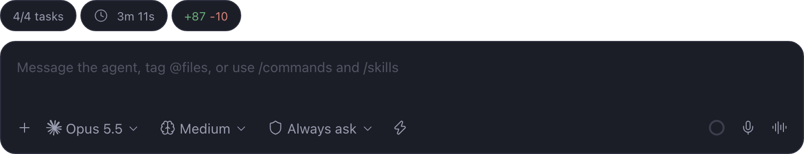
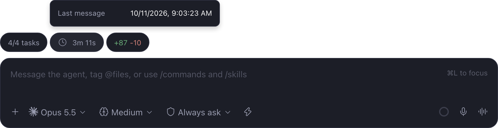
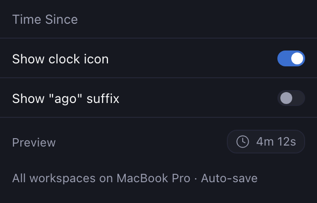

# time-since

Paseo 0.11 composer pill that ticks elapsed time since the last `user_message` or `assistant_message` in the agent thread.

It sits in the track above the composer. The plugin's server records when each agent turn ends, so after closing and reopening Paseo the clock still counts from the agent's last reply. Turns that ended before this plugin was installed fall back to the last user message, then the agent's creation time; those read older than the true reply, never newer. Live thread messages advance the clock while Paseo is open. It does not replace Paseo's message renderer.

Shows `4m 12s` for the first five minutes, then `12m` / `4h 12m` with no seconds. Hidden while a turn is running. Press the pill to open a popover with the absolute timestamp.





Open **Time Since Options** in Command Center to show or hide the clock icon and add an optional `ago` suffix, such as `4m 12s ago`. The panel includes a preview. Changes apply to all workspaces on the connected host and persist across restarts. The icon starts on and the suffix starts off.



## Install

Paseo 0.11 or later. Enable plugins in **Settings → Plugins**, then:

```bash
paseo plugin add npm:@stevecastaneda/paseo-time-since
```

Or from Paseo's plugin registry: `paseo plugin add stevecastaneda/time-since`.

From a local checkout:

```bash
npm install
npm run typecheck
paseo plugin install /absolute/path/to/time-since
```

After source changes:

```bash
npm run typecheck
paseo plugin reload time-since
```

## Updates

Agent changes arrive through a subscription rather than repeated list requests.
Elapsed time is calculated locally; the clock does not request settings from
the daemon every second, and it never reads an agent timeline, which would
start that agent's provider process. At launch it makes one request for the
recorded turn ends of every agent. Labels update only when their displayed
value changes.

Saved options apply immediately in the current client. Other connected clients
pick them up when they next load the options or reload the plugin.

## Changelog

### 0.4.0

- Needs Paseo 0.11 or later. The plugin now carries its own icon and screenshots, and Paseo 0.9 and 0.10 refuse to load a plugin that does. On an older Paseo, the version you already have keeps working.
- The plugin store now takes the icon and screenshots from each release, so they match the version you install.
- New screenshots in this README.

### 0.3.3

- Installing the plugin no longer downloads any other npm packages. The plugin used to install `@getpaseo/client` just for its types; it now gets them from the plugin SDK that Paseo already provides.

### 0.3.2

- The plugin's page in Paseo's plugin store now uses the plugin's own description instead of text the store copied from paseo.cafe.

### 0.3.1

- Installs again with npm 12. Installing failed with `npm ci` asking for a `package-lock.json`, because npm 12 no longer reads the lockfile this plugin shipped ([#53](https://github.com/stevecastaneda/paseo-plugins/issues/53)). The plugin no longer runs its own install step; Paseo's npm install already brings in what it needs.
- Install from npm or Paseo's plugin registry. Installing straight from GitHub no longer works.
