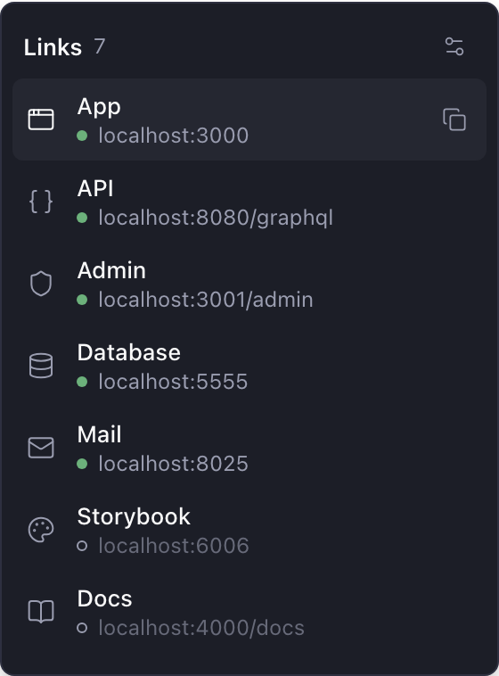
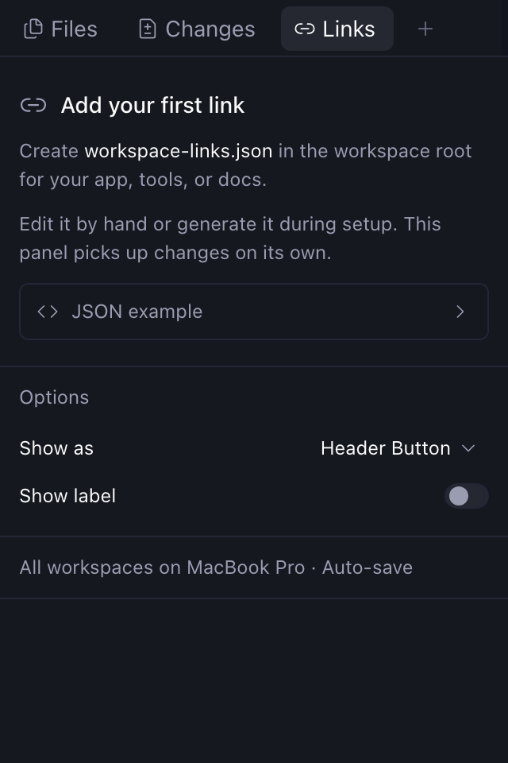

# Workspace Links

A small Paseo plugin (0.11 or later) that reads `workspace-links.json` from the active workspace and puts those URLs on the Links trigger. Press the composer pill or header button to see each link's name with its URL underneath, then choose one to open it in your browser, or copy its URL. The settings button in the popover (or **Add links** when the file is empty or missing) opens the setup panel in Explorer. The Command Center item **Workspace Links** opens that panel too.



The trigger stays available when the workspace has no links yet, so the setup guide is always one click away. The panel never opens automatically.

Under **Show as**, switch between the composer pill and a workspace header button. Header buttons can hide the **Links** label. Changes apply to all workspaces on the connected host and persist across restarts. The composer pill is the default.



## Install

```sh
paseo plugin add npm:@stevecastaneda/paseo-workspace-links
```

From Paseo's plugin registry: `paseo plugin add stevecastaneda/workspace-links`.

Enable plugins under **Settings → Plugins** on the Paseo host.

## Configuration

Put this file at the workspace root:

```json
[
  { "label": "App", "url": "http://localhost:3000" },
  { "label": "Admin", "url": "http://localhost:3001" },
  { "label": "Docs", "url": "https://example.com/docs" }
]
```

Use fixed URLs or have your existing setup/dev script generate this same file with the workspace's current URLs. Gitignore it if it contains workspace-specific values. The popover and the panel reread the file every two seconds while they are open, so there is nothing to refresh. The plugin does not execute scripts.

Links open on the **device you're using**, the same way Paseo opens its own links: your default browser in the desktop app, a new tab in the web app, or the phone's browser in the mobile app.

`localhost` therefore refers to that device. When the daemon runs on another machine, or you use Paseo from your phone, `localhost` links reach the daemon's dev server only if that port is forwarded to your device.

The status dots are checked from the machine running Paseo, so a `localhost` link can show as running even when it won't open on your phone.

Only HTTP(S) URLs are supported, with up to 100 links. Missing configuration, empty lists, and invalid files have visible panel states.

## Updates

Workspace and agent changes arrive through subscriptions rather than repeated
list requests. The Links popover and panel reread the file every two seconds
while they are open.

Placement changes apply immediately in the current client. Other connected
clients pick up saved options when they next load the options or reload the
plugin.

## Changelog

### 1.0.0

- Version 1.0. Nothing you use changes. From now on, a new first number means an update breaks something, a new middle number means a new feature, and a new last number means a fix.
- The button, the Explorer tab, the Command Center entry and the empty states all use the same flat chain icon now. The tab and Command Center used an open-in-browser arrow, and the button a slanted chain.
- The Links panel no longer opens with a "Workspace Links" bar and a Refresh button. The panel already rereads `workspace-links.json` every two seconds, so the button did nothing you'd notice.
- The setup guide says the panel picks up changes on its own, instead of asking you to refresh.
- New screenshot of the Links panel in this README.

### 0.6.0

- Needs Paseo 0.11 or later. The plugin now carries its own icon and screenshots, and Paseo 0.9 and 0.10 refuse to load a plugin that does. On an older Paseo, the version you already have keeps working.
- The plugin store now takes the icon and screenshots from each release, so they match the version you install.
- New screenshots in this README.

### 0.5.3

- Installing the plugin no longer downloads any other npm packages. The plugin used to install `@getpaseo/client` just for its types; it now gets them from the plugin SDK that Paseo already provides.

### 0.5.2

- The plugin's page in Paseo now explains that Paseo checks the status dots on the computer where the workspace runs, so a green `localhost` link may still not open on your phone.
- A screenshot of the Links popover, with its status dots and copy button, at the top of this README.

### 0.5.1

- Installs again with npm 12. Installing failed with `npm ci` asking for a `package-lock.json`, because npm 12 no longer reads the lockfile this plugin shipped ([#53](https://github.com/stevecastaneda/paseo-plugins/issues/53)). The plugin no longer runs its own install step; Paseo's npm install already brings in what it needs.
- Install from npm or Paseo's plugin registry. Installing straight from GitHub no longer works.

### 0.5.0

- The Links popover shows each link's URL under its name. Long URLs are shortened in the middle.
- Each link gets an icon picked from its name or URL: docs, admin, auth, database, storage, API and more.
- A green dot shows which links are running. Paseo checks them every few seconds while the popover is open. A hollow dot means nothing answered.
- Hover a link to copy its URL.
- A friendlier empty state with an **Add links** button.
